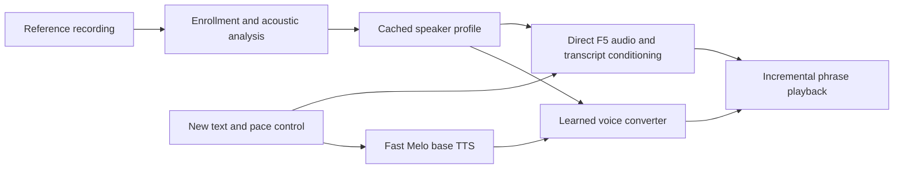

# T-2000

An extension of T-1000 for local voice cloning on an NVIDIA RTX 3050 with 4 GB of VRAM, with reference voice similarity taking priority over generation speed.

The objective is to reduce time to audible speech and sustain generation faster than playback while preserving speaker identity, intelligibility, and natural delivery.

**Current status:** the studio offers installed F5, T-1000 SOAR, T-1000 MF2, and Melo/OpenVoice engines for comparison. The user's own voice is the target, especially accent, sentence flow, naturalness and emotion. Earlier F5 similarity/ASR proxies did not establish perceived quality; subsequent listening feedback prompted a [reference-context controller and direct T-1000 comparison](docs/reference-delivery-2026-10-30.md). The original fast cascade remains available and is the portable configuration default. Historical measurements remain in the [voice experiment](docs/voice-quality-2026-10-30.md) and [original GPU speed record](docs/gpu-validation-2026-10-30.md).

The studio now follows T-1000's layout, transcribes saved references by default, and keeps transcripts editable. It includes native-rate microphone/WAV enrollment, diagnostics, cached reference preparation, phrase playback, cancellation and WAV export. Both backends produce complete phrases; frame-level neural streaming and exact copying of pitch, intonation or emotion are not implemented.

Reference enrollment is separate from speech generation:



The converter must learn a speaker-conditioned transformation. An ordinary EQ can adjust spectral balance but cannot perform full voice cloning. The base TTS must provide useful intonation and rhythm; a tone-color converter cannot be assumed to recover those from a monotone source. This division is demonstrated by [OpenVoice](https://github.com/myshell-ai/OpenVoice/blob/main/docs/QA.md).

The [matched evaluation harness](docs/voice-quality-2026-10-30.md) compares complete outputs, transcripts, independent speaker embeddings, pitch diagnostics and speaking pace. A matched T-1000 model comparison and human listening evaluation remain pending.

See [the architecture and benchmark proposal](docs/architecture.md) for T-1000 reuse, reference features, candidate models, RTX 3050 constraints, and evaluation criteria.

## Start the studio

On any machine with an NVIDIA GPU, Docker Engine with the Compose plugin, and the
NVIDIA Container Toolkit:

```sh
docker compose up -d --build
```

That is the whole setup. No host checkout of T-1000, no virtual environment and
no manual model download: the image carries the studio and the pinned `dots.tts`
runtime, and the first start fetches and verifies about 10 GB of weights into a
named volume. Watch it with `docker compose logs -f studio`, then open
**http://127.0.0.1:7861** on that machine, or forward port 7861 over SSH.

The image ships T-1000 SOAR and MF2 and defaults to the `high-vram` profile:
a dense BF16 language model with the upstream sequence limits, sized for cards
with roughly 8 GB of VRAM or more. On a 16 GB card it needs no tuning. Smaller
cards can set `T2000_T1000_PROFILE=low-vram`, which quantizes the language model
to NF4 and additionally needs bitsandbytes in the worker environment.

On the original 3050 laptop, `./start.sh` still reuses the installed image or
its recovery archive and releases the native T-1000 studio's GPU first.
See [Docker setup and operations](docs/docker.md) for profiles, the model
provisioning step, persistent data, and stop/log commands.

Use Python 3.11 and [uv](https://docs.astral.sh/uv/). From this directory:

```sh
uv venv --python 3.11 .venv
uv pip install --python .venv/bin/python -c requirements/constraints.txt -e '.[dev,stt]'
.venv/bin/t2000 serve
```

Open **http://127.0.0.1:7861**. Recording, enrollment and diagnostics work without the synthesis stack. Speech generation requires the inference dependencies and models; there is no substitute audio fallback.

For CPU synthesis:

```sh
uv pip install --python .venv/bin/python -r requirements/inference-cpu.txt
.venv/bin/python scripts/setup_models.py
.venv/bin/python scripts/setup_models.py --check
.venv/bin/t2000 serve --preload
```

Model setup explicitly downloads pinned weights, source, tokenizers and NLP resources. See [model setup](docs/models.md) for details. Use the separate [GPU and SSH guide](docs/gpu.md) on the RTX 3050; install one inference profile per environment.

For the F5 backend, keep the application and CPU recognition in `.venv` and install synthesis in a separate environment:

```sh
uv venv --python 3.11 .venv-f5
uv pip install --python .venv-f5/bin/python -r requirements/inference-f5.txt
.venv/bin/python scripts/setup_f5.py
.venv/bin/python scripts/setup_f5.py --check
.venv/bin/python scripts/fetch_stt.py
T2000_BACKEND=f5-tts-v1 T2000_F5_PYTHON=.venv-f5/bin/python \
  T2000_F5_STEPS=32 T2000_TTS_DEVICE=cuda:0 .venv/bin/t2000 serve --preload
```

F5 pretrained weights are licensed CC-BY-NC-4.0; its code is MIT. See the [model card](https://huggingface.co/SWivid/F5-TTS/tree/84e5a410d9cead4de2f847e7c9369a6440bdfaca). F5 is slower than the original cascade, and some tested requests generated more slowly than playback.

## Use a voice

1. Record or upload clean single-speaker speech up to **30 seconds**. Native sample rate is preserved. Browser microphone capture requests noise suppression and echo cancellation where supported. The saved reference must fit the selected engine: **1–12 seconds** for F5 (aim for **8–12 seconds**), **1–6 seconds** for T-1000, or **1–30 seconds** for Melo/OpenVoice.
2. Use **Clean up and trim** to choose start/end times, reduce background noise (on by default), or trim quiet edges automatically. Click **Preview changes**, listen, and compare with the original. Keep at least one second of speech and trim to the engine's limit; **Reset edits** restores the full recording and default cleanup settings. Suppression targets steady hiss and hum; competing voices, music and strong room echo may remain.
3. Save the previewed reference. CPU STT runs by default; review and correct the exact words. F5 and T-1000 require the matching transcript. Automatic recognition preserves existing manual corrections, including corrections saved while recognition is running. Cropping clears draft words so the transcript can match the kept speech. Cleanup runs before analysis, transcription and voice conditioning. **Clean up or trim this voice** edits a saved reference as a new copy, keeping the previous voice and its cached conditioning available.
4. Choose **Prepare voice for generation** to load models and cache conditioning before timing a request. The first Generate also prepares a voice when needed.
5. Enter new English text and generate. Each complete phrase plays as it becomes available. With F5, **Reference pace** at 1.0× estimates pace from reference duration and transcript length; it does not reproduce the exact pitch or intonation contour. Stop clears playback and requests cancellation between model calls.

Use **Voice engine** to compare the same recording and words. Installed T-1000 SOAR/MF2 reuse their existing runtime and accept complete 1–6 second references. They preserve native model delivery at 1.0×; the speed slider is disabled rather than applying a pitch or tempo effect. Switching unloads the previous engine before another loads, and is refused during generation. Fitting F5/T-1000 passages keep adjacent sentence context; longer text splits only when the engine budget requires it.

The studio shows estimated first-audible latency, generation time, real-time factor (RTF), and playback gaps. **RTF below 1** means generation is faster than playback. Audible timing is estimated from browser rendering/device latency. Server generation timing excludes loading and enrollment, which are logged separately.

To reuse T-1000's downloaded recognition weights, point `STT_MODEL_DIR` at that model directory. Otherwise download explicitly with `.venv/bin/python scripts/fetch_stt.py`. A manual reference transcript works without STT; CLI enrollment can opt out with `--no-transcribe`. The plots describe reference acoustics; they do not certify identity, emotion or smoothness.

## CLI and benchmarking

```sh
.venv/bin/t2000 doctor
.venv/bin/t2000 enroll /path/to/reference.wav --name 'My voice' --prepare
.venv/bin/t2000 enroll /path/to/reference.wav --name 'Clean voice' --start-seconds 0.5 --end-seconds 8 --auto-trim
.venv/bin/t2000 generate --profile PROFILE_ID --text 'Hello, this is a voice test.'
.venv/bin/python scripts/benchmark.py --reference /path/to/reference.wav \
  --repeats 3 --output-dir data/benchmarks/first-run
```

Enrollment prints the profile ID. The benchmark uses [eight English cases](benchmarks/english.json), randomized request order, excluded warmups and separate loading/preparation measurements. It saves JSON, CSV, Markdown, request metadata and WAV paths. Failures remain in failure counts and do not enter successful latency summaries. Repeat `--reference` for more voices. See [the GPU guide](docs/gpu.md) for measurement limits.

CLI and API enrollment enable background suppression by default; CLI `--no-noise-reduction` or API form field `noise_reduction=false` keeps the original sound. `start_seconds`, `end_seconds`, and `auto_trim` are also available as enrollment form fields. `POST /api/reference/preview` accepts the same audio and processing fields and returns a disposable WAV without creating a profile. Programmatic `ProfileStore.create` preserves its original default behavior unless processing options are supplied. References over 30 seconds must be shortened before upload.

## Configuration

| Variable | Default | Effect |
|---|---|---|
| `T2000_DATA_DIR` | `./data` | Profiles, generated WAVs and reports. |
| `T2000_MODEL_DIR` | models under the data directory | Prepared synthesis stack. |
| `T2000_BACKEND` | `melo-openvoice-v2` | Select `f5-tts-v1`, `t1000-soar` or `t1000-mf2` when installed. |
| `T2000_F5_PYTHON` | `.venv-f5/bin/python` | Isolated F5 interpreter; keep its virtual environment path. |
| `T2000_F5_STEPS` | `32` | F5 sampling steps, 8–64. |
| `T2000_T1000_ROOT` | `../T-1000` | Existing T-1000 checkout containing its verified models. |
| `T2000_T1000_PYTHON` | `../T-1000/.venv/bin/python` | Existing isolated T-1000 interpreter; retain its environment path. |
| `T2000_TTS_DEVICE` | `cpu` | F5 or Melo/BERT placement. |
| `T2000_CONVERTER_DEVICE` | `cpu` | Converter/watermark placement; start with `cuda:0` on the 3050. |
| `T2000_NUM_THREADS` | `4` | Torch and CPU STT thread setting. |
| `T2000_SPEAKER` | `EN-US` | Base voice; changes invalidate conditioning. |
| `T2000_LANGUAGE` | `EN` | Initial backend supports English. |
| `T2000_REFERENCE_MODE` | `full` | Melo reference conditioning; `speech` enables the optional pinned VAD experiment. |
| `T2000_CONVERSION_TAU` | `0.3` | Melo/OpenVoice posterior noise scale; not cloning strength. |
| `STT_MODEL_DIR` | Nemotron subdirectory under models | Optional CPU recognition weights. |

Run one server process per GPU. Keep the default loopback binding and use an SSH tunnel for remote access. Recordings, profiles and outputs remain under `data/`; keep them out of Git and remove them when no longer needed. The model runtime uses prepared local resources and disables Hugging Face online loading.

On the GPU laptop itself, open **http://127.0.0.1:7861** directly. Return to the fast backend by setting `T2000_BACKEND=melo-openvoice-v2`, choosing its placement variables, and restarting the process.

## Validation

```sh
.venv/bin/pytest -q
.venv/bin/ruff check src tests scripts
node scripts/check_browser.mjs
```

Core transport tests use an injected signal source, not a runnable speech backend or a performance result. Optional real-browser checks are described in [development notes](docs/development.md). Real inference and target GPU measurements are separate checks. CosyVoice and a custom converter remain future experiments.

See [the validation record](docs/validation.md) for CPU/model checks, completed GPU validation, and the remaining listening and playback measurements.
