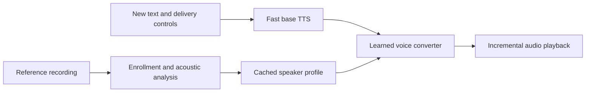

# T-2000

An extension of T-1000 for faster local voice cloning, targeting an NVIDIA RTX 3050 with 4 GB of VRAM.

The objective is to reduce time to audible speech and sustain generation faster than playback while preserving speaker identity, intelligibility, and natural delivery.

**Current status:** first implementation. Includes a browser studio, native-rate microphone/WAV enrollment, waveform/pitch/spectrum diagnostics, cached conditioning, optional CPU STT, MeloTTS/OpenVoice V2 inference, phrase playback, cancellation, WAV export, and a benchmark runner. Target GPU fit, speed and speaker quality still need measurement. Conversion operates on complete phrases; arbitrary emotion transfer and frame-level neural streaming are not implemented.

The proposed system separates reference enrollment from speech generation:



The converter must learn a speaker-conditioned transformation. An ordinary EQ can adjust spectral balance but cannot perform full voice cloning. The base TTS must provide useful intonation and rhythm; a tone-color converter cannot be assumed to recover those from a monotone source. This division is demonstrated by [OpenVoice](https://github.com/myshell-ai/OpenVoice/blob/main/docs/QA.md).

The first experiment compares this cascade with direct voice cloning, including T-1000's existing control. Adding a converter is a hypothesis to test, rather than an established speed improvement.

See [the architecture and benchmark proposal](docs/architecture.md) for T-1000 reuse, reference features, candidate models, RTX 3050 constraints, and evaluation criteria.

## Start the studio

Use Python 3.11 and [uv](https://docs.astral.sh/uv/). From this directory:

```sh
uv venv --python 3.11 .venv
uv pip install --python .venv/bin/python -c requirements/constraints.txt -e '.[dev,stt]'
.venv/bin/t2000 serve
```

Open **http://127.0.0.1:7861**. Recording, enrollment and diagnostics work without the synthesis stack. Speech generation requires the inference dependencies and models; there is no substitute audio fallback.

For CPU synthesis:

```sh
uv pip install --python .venv/bin/python -r requirements/inference-cpu.txt
.venv/bin/python scripts/setup_models.py
.venv/bin/python scripts/setup_models.py --check
.venv/bin/t2000 serve --preload
```

Model setup explicitly downloads pinned weights, source, tokenizers and NLP resources. See [model setup](docs/models.md) for details. Use the separate [GPU and SSH guide](docs/gpu.md) on the RTX 3050; install one inference profile per environment.

## Use a voice

1. Record or upload a clean **1–30 second** single-speaker clip. Native sample rate is preserved; a clear 3–10 second spoken sample is a useful starting point.
2. Save the reference. Optionally transcribe it with CPU STT; Melo/OpenVoice does not require the transcript for cloning.
3. Choose **Prepare voice for generation** to load models and cache conditioning before timing a request. The first Generate also prepares a voice when needed.
4. Enter new English text and generate. Each converted phrase plays as it becomes available. Stop clears playback and requests cancellation between model calls.

The studio shows estimated first-audible latency, generation time, real-time factor (RTF), and playback gaps. **RTF below 1** means generation is faster than playback. Audible timing is estimated from browser rendering/device latency. Server generation timing excludes loading and enrollment, which are logged separately.

To reuse T-1000's downloaded recognition weights, point `STT_MODEL_DIR` at that model directory. Otherwise download explicitly with `.venv/bin/python scripts/fetch_stt.py`. A manual reference transcript works without STT. The plots describe reference acoustics; they do not certify identity or emotion.

## CLI and benchmarking

```sh
.venv/bin/t2000 doctor
.venv/bin/t2000 enroll /path/to/reference.wav --name 'My voice' --prepare
.venv/bin/t2000 generate --profile PROFILE_ID --text 'Hello, this is a voice test.'
.venv/bin/python scripts/benchmark.py --reference /path/to/reference.wav \
  --repeats 3 --output-dir data/benchmarks/first-run
```

Enrollment prints the profile ID. The benchmark uses [eight English cases](benchmarks/english.json), randomized request order, excluded warmups and separate loading/preparation measurements. It saves JSON, CSV, Markdown, request metadata and WAV paths. Failures remain in failure counts and do not enter successful latency summaries. Repeat `--reference` for more voices. See [the GPU guide](docs/gpu.md) for measurement limits.

## Configuration

| Variable | Default | Effect |
|---|---|---|
| `T2000_DATA_DIR` | `./data` | Profiles, generated WAVs and reports. |
| `T2000_MODEL_DIR` | models under the data directory | Prepared synthesis stack. |
| `T2000_TTS_DEVICE` | `cpu` | Melo/BERT placement. |
| `T2000_CONVERTER_DEVICE` | `cpu` | Converter/watermark placement; start with `cuda:0` on the 3050. |
| `T2000_NUM_THREADS` | `4` | Torch and CPU STT thread setting. |
| `T2000_SPEAKER` | `EN-US` | Base voice; changes invalidate conditioning. |
| `T2000_LANGUAGE` | `EN` | Initial backend supports English. |
| `STT_MODEL_DIR` | Nemotron subdirectory under models | Optional CPU recognition weights. |

Run one server process per GPU. Keep the default loopback binding and use an SSH tunnel for remote access. Recordings, profiles and outputs remain under `data/`; keep them out of Git and remove them when no longer needed. The model runtime uses prepared local resources and disables Hugging Face online loading.

## Validation

```sh
.venv/bin/pytest -q
.venv/bin/ruff check src tests scripts
node scripts/check_browser.mjs
```

Core transport tests use an injected signal source, not a runnable speech backend or a performance result. Optional real-browser checks are described in [development notes](docs/development.md). Real inference and target GPU measurements are separate checks. CosyVoice and a custom converter remain future experiments.

See [the initial validation record](docs/validation.md) for completed CPU/model checks and the remaining GPU work.
