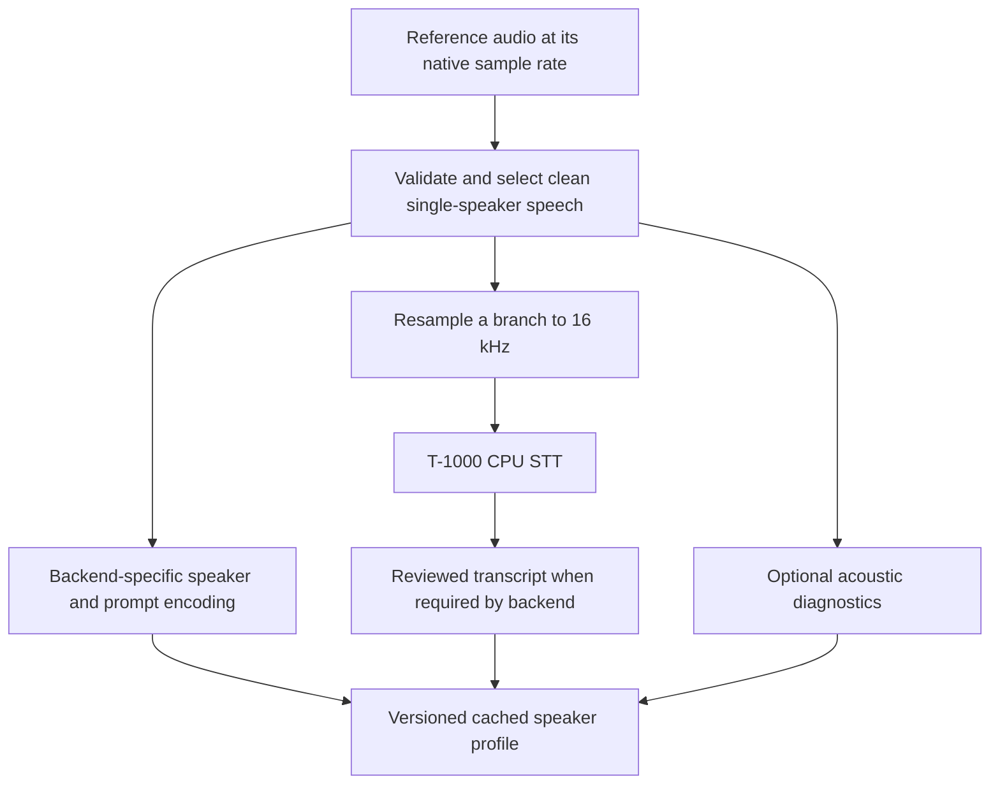

# T-2000 architecture proposal

Design reviewed on 2026-10-29. Target hardware: RTX 3050, interpreting the user's 4 GB specification as GPU VRAM. Available system RAM and CPU are unconfirmed. The initial working assumption is new text spoken in a reference voice, with English inherited from T-1000; live conversion and other languages remain separate requirements to resolve.

Implementation update: the first MeloTTS/OpenVoice route, reference profiles, diagnostics, optional CPU STT, phrase playback and timing runner are available. See [the README](../README.md) and [GPU setup](gpu.md). Direct CosyVoice comparison, custom converter training and general emotion transfer remain proposed experiments. No target GPU speedup or quality parity is established by the implementation.

## What the proposed pipeline gets right

Separating speech generation from speaker identity is a viable architecture. A small base TTS can generate linguistic content and delivery, and a learned converter can transform its voice toward the reference speaker. Whether this is faster or more accurate than direct cloning on a 4 GB GPU is an experimental question.

The final stage is a neural voice converter, rather than an EQ or a quality judge. An EQ applies frequency-dependent gain. Speaker identity also involves changing harmonic structure, phoneme-dependent resonances, voicing, articulation, and timing. There is no single frequency-response curve that describes a person's voice across arbitrary words and emotions. Frequency graphs help diagnose a model; matching average spectra does not establish a voice match.

[OpenVoice's paper](https://arxiv.org/abs/2312.01479) describes a base TTS plus tone-color converter. Its [official QA](https://github.com/myshell-ai/OpenVoice/blob/main/docs/QA.md) assigns accent and emotion to the base TTS, while the converter transfers tone color. For this design, use a consistent base speaker with natural prosody. Intentional monotony would remove delivery that this converter is not designed to reconstruct.

Autoregressive generation is not inherently the fastest choice: it has sequential decoding steps. Parallel synthesis is also worth testing; [VITS](https://github.com/jaywalnut310/vits) is one established example. A fixed speaker and repeatable settings are useful controls, but determinism alone does not reduce inference cost or guarantee identical output across runtimes.

## Enrollment: once per reference

STT extracts words. Acoustic analysis is a parallel branch operating on the recording, rather than a feature expected from the transcript.

| Information | Purpose |
|---|---|
| Backend speaker embedding and prompt features | Actual model conditioning; retain the representations required by that backend. |
| Fundamental frequency (F0) and voiced/unvoiced mask | Pitch range, pitch variation, and voicing diagnostics. |
| Energy envelope and pauses | Loudness variation and delivery diagnostics. |
| Mel spectrogram or spectral envelope | Time-varying spectral inspection; useful for comparing similar phonetic content. |
| Optional phoneme alignment and duration statistics | Deeper pronunciation/rhythm analysis when the experiment needs it. |

Preserve native reference audio, then resample separately for each model. T-1000's [recorder](../../T-1000/apps/web/src/lib/recorder.ts) currently requests 16 kHz capture; this limits retained bandwidth before synthesis. Keeping native 24/48 kHz where the device supports it gives backends access to more detail, without claiming that higher sample rate alone improves identity.

Do not impose a reference sentence's exact pitch contour on unrelated new text. Word timing, questions, emphasis, and phoneme counts differ. Cache useful speaker/style representations or statistics; generate delivery appropriate to the new text.

Cache keys must include the reference audio hash, model/checkpoint version, preprocessing version, and relevant settings. Each backend has its own profile format. References and embeddings are not interchangeable across models.

## Generation: each new request

The cascade is:

`new text + delivery controls -> base TTS -> speaker-conditioned converter -> PCM -> playback`

The direct baseline is:

`new text + cached reference conditioning -> cloning TTS -> PCM -> playback`

For typed text, STT and reference analysis stay outside the generation path. For spoken input that needs transcription or editing, recognition adds its own delay. If the goal is live voice changing while preserving the spoken words and delivery, evaluate direct speech-to-speech conversion; STT followed by TTS is not a necessary prerequisite.

Pitch, emotion, speaking rate, and accent controls depend on the selected model's actual interface. A timbre converter alone does not supply arbitrary control over all of them.

Keep models resident, reuse reference conditioning, avoid intermediate WAV serialization where a compatible in-memory interface can be implemented, and start with one synthesis request at a time. Playback should accept ordered PCM packets with sample-rate metadata and a bounded buffer. Capture recovery, cancellation, and final WAV export can reuse T-1000's existing patterns.

## First model experiments on the RTX 3050

| Route | Initial experiment | What it establishes |
|---|---|---|
| Existing direct control | T-1000's SOAR/MF2 setup and saved references | A measured starting point and reusable comparison audio. |
| Modular cascade | MeloTTS base speaker on CPU, OpenVoice V2 converter on GPU; also measure alternative placement if CPU becomes the bottleneck | A supported pairing close to the proposed architecture. Fit, CPU contention, latency, and voice quality still need measurement. |
| Streaming direct candidate | CosyVoice 3 0.5B, only after a load-and-generation memory check | Whether a direct streaming model beats the cascade within available VRAM. |

The [official OpenVoice V2 example](https://github.com/myshell-ai/OpenVoice/blob/main/demo_part3.ipynb) pairs MeloTTS with the converter and loads source/target speaker conditioning. Keep the source embedding matched to the actual base speaker; replacing the base model requires establishing compatible source conditioning.

The [OpenVoice converter API](https://github.com/myshell-ai/OpenVoice/blob/main/openvoice/api.py) processes a complete source waveform. It does not expose a streaming generator. A first prototype can operate on complete short phrases, but phrase segmentation is not proof of continuous low-latency conversion. Smaller chunks require context/overlap experiments and checks for joins, lost consonants, and pitch discontinuities.

[CosyVoice's official repository](https://github.com/QwenAudio/CosyVoice) documents text-input/audio-output streaming. Its [inference API](https://github.com/QwenAudio/CosyVoice/blob/main/cosyvoice/cli/cosyvoice.py) supports caching zero-shot speaker inputs. Its published minimum latency is not a prediction for the RTX 3050. Model parameter count also excludes activation, cache, vocoder, runtime, and desktop memory costs.

Retain T-1000's CPU STT to leave VRAM available for synthesis. Record idle board memory, whole-process GPU use, and PyTorch allocated/reserved peaks separately. Test the intended maximum text/reference lengths and repeated requests, rather than inferring fit from a successful model load. Available system RAM must also be measured before choosing CPU placement.

## Existing evidence from T-1000

These are saved T-1000 results, not new T-2000 benchmarks. They are separate experiments and should not be combined into a new paired speed ratio.

| Experiment | Median full generation | Median first host PCM | Median real-time factor |
|---|---:|---:|---:|
| SOAR with compiled FP32 vocoder | 9.983 s | 0.956 s | 2.975 |
| MF2 in the earlier model comparison | 4.299 s | Not reported in the summary | 1.225 |

Sources: [SOAR optimization results](../../T-1000/data/output/3050-soar-optimizations/RESULTS.md), [model comparison](../../T-1000/data/output/3050-model-comparison/scores/COMPARISON.md). Each summarized configuration has 16 timed complete requests. The quality samples are limited, and repeated timings are not independent quality examples.

Real-time factor is generation time divided by generated audio duration. Time generation from the start of request processing through production of the final PCM sample, including the synthesis/conversion stages and their transfers, but excluding enrollment and playback time. Report queue delay separately. Values above 1 mean synthesis is slower than playback. First host PCM excludes browser transport and audio-device buffering; early audio alone does not ensure uninterrupted playback.

The existing speaker cosine uses a conditioning encoder and is an optimistic proxy. ASR agreement measures one recognizer's transcription. Neither establishes human-perceived identity or naturalness. T-1000's [web player](../../T-1000/apps/web/src/App.tsx) currently fetches the completed WAV, so incremental audible playback requires additional implementation.

## Benchmark and decision

Use the same references, novel target texts, hardware settings, and completion rules across routes. Include short/long sentences, questions, numbers, names, and varied delivery. Use clean reference recordings plus held-out real recordings of each speaker for independent similarity evaluation. Keep enrollment recordings distinct from evaluation recordings.

Measure:

- Cold load, enrollment, and warm request latency separately.
- Server time to first PCM and browser time from Generate to the first rendered speech sample; account for leading silence and audio-device output latency when estimating audible delay.
- Complete-generation real-time factor, inter-chunk gaps, playback underruns, and cancellation delay.
- Generated duration, speaking rate, and leading/trailing or excess silence, so slower or padded speech cannot be mistaken for an RTF improvement.
- Peak GPU/system memory and behavior over repeated requests.
- Word/character errors, missing/repeated content, independent speaker similarity, and blinded paired listening for identity and naturalness.

Count only fully completed outputs as successful latency results; retain partial/error cases in failure reporting. Report p50/p95 on enough requests to make tail estimates meaningful, with exact case/repetition counts and hardware details. Randomize or alternate model order to reduce thermal/order bias.

The first functional target is sustained end-to-end generation below RTF 1 with no playback underruns on the benchmark. A warm first-audible target below 500 ms is an initial aspiration, not an achieved result or hardware guarantee. Choose the fastest route that also maintains acceptable intelligibility, identity, and naturalness in listening tests. Do not select a winner by average spectral similarity alone.

## If developing a custom converter

Start with a pretrained converter as a feasibility baseline. A custom model would condition on speech content/acoustic features and target speaker identity, with explicit pitch/style controls where supported, then reconstruct audio through a neural decoder or vocoder. A small fixed-source converter or distilled student is a later optimization to investigate.

Training and quality scoring belong outside the request path. Spectral reconstruction losses need aligned examples of the same spoken content; comparing unrelated reference/generated spectrograms as if they should match would reward the wrong transformation. A production request should perform one conditioned conversion pass rather than repeatedly generate, score, and regenerate.

## Implementation order

1. Establish matched controls from T-1000 and implement enrollment/profile caching with native-rate reference preservation and the CPU STT branch.
2. Benchmark the supported MeloTTS/OpenVoice V2 cascade before attempting custom training. Check a direct streaming candidate if it fits.
3. Add incremental PCM playback and measure full browser behavior; make chunk/context changes only with listening and underrun checks.
4. Select the route from measured latency and quality, then consider distillation, quantization, or custom conversion if a specific bottleneck remains.
